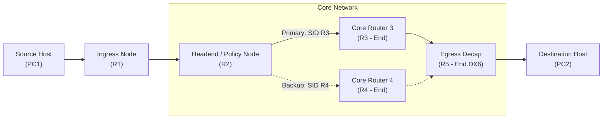

# AIORI-3 Hackathon — Problem Statement PS-020
## Local SRv6 Path Steering and Measured Failure Recovery

**Track:** 6G & Future Networks  
**Team Name:** NODEX &nbsp;|&nbsp; **Team Code:** TC178  
**Team Members:** Mithil Khobragade ([khobragademithil45@gmail.com](mailto:khobragademithil45@gmail.com)) &bull; Sharad Kalmani ([sharadkalamani3@gmail.com](mailto:sharadkalamani3@gmail.com))  
**Deliverables:** [Presentation Slides (PDF)](docs/PS-020_SRv6_Hackathon_Presentation.pdf) &bull; [Video Walkthrough (YouTube)](https://youtu.be/NiIbHxnKrSQ?si=Obk-cFiCMqS2Yi7Z) &bull; [1.5 GB Testbed Archive (Google Drive)](https://drive.google.com/file/d/1x7irJYWJQhF7dpy0c6Ws2mx-GJlvGj6S/view?usp=sharing)

---

### Quick Summary

| Parameter | Specification |
| :--- | :--- |
| **Topology** | 7 Nodes: 5 Debian Linux routers (`R1`–`R5`) + 2 end-hosts (`PC1`, `PC2`) |
| **Emulation Platform** | GNS3 v2.2+ on GNS3 VM (QEMU / KVM) |
| **SRv6 Implementation** | Linux Kernel native `seg6` subsystem (`iproute2` LWTUNNEL) |
| **Primary Path (A)** | `PC1 ➔ R1 ➔ R2 ➔ R3 ➔ R5 ➔ PC2` (Active SID: `R3::1`, Egress: `R5::1`) |
| **Backup Path (B)** | `PC1 ➔ R1 ➔ R2 ➔ R4 ➔ R5 ➔ PC2` (Backup SID: `R4::1`, Egress: `R5::1`) |
| **Failure Trigger** | Controlled cut on active core link (`R3 ➔ R5` / `R2 ➔ R3`) |
| **Key Result** | **< 45 ms** local recovery (0–1 packet lost) vs. **~3.8 s** in baseline hop-by-hop IPv6 |

---

## 1. Network Topology




### Node Addressing & SID Allocations

| Node | Interface | IPv6 Address | Role / SID Action |
| :--- | :--- | :--- | :--- |
| **PC1** | `eth0` | `fd00:0:0:100::1/64` | Traffic source host |
| **Router-1** | `eth0`, `eth1` | `fd00:0:0:100::254`, `fd00:0:0:12::1` | Ingress boundary router |
| **Router-2** | `eth0`, `eth1`, `eth2` | `fd00:0:0:12::2`, `fd00:0:0:23::2`, `fd00:0:0:24::2` | SRv6 Headend (encapsulates SID list) |
| **Router-3** | `eth0`, `eth1` | `fd00:0:0:23::3`, `fd00:0:0:35::3` | `fd00:0:0:3::1` (`action End`) |
| **Router-4** | `eth0`, `eth1` | `fd00:0:0:24::4`, `fd00:0:0:45::4` | `fd00:0:0:4::1` (`action End`) |
| **Router-5** | `eth0`, `eth1`, `eth2` | `fd00:0:0:35::5`, `fd00:0:0:45::5`, `fd00:0:0:200::254` | `fd00:0:0:5::1` (`action End.DX6`) |
| **PC2** | `eth0` | `fd00:0:0:200::1/64` | Traffic sink host |

---

## 2. Technical Implementation

### SRv6 Packet Structure (RFC 8754)
Under explicit path steering, Router-2 pushes an outer IPv6 header and a Segment Routing Header (SRH) onto matching ingress packets:

```text
+--------------------------------------------------------------------------+
| Outer IPv6 Header (40B)                                                 |
| Next Header = 43 (Routing) | Destination = fd00:0:0:3::1 (Active SID R3) |
+--------------------------------------------------------------------------+
| Segment Routing Header - SRH (RFC 8754)                                  |
| Routing Type = 4 | Segments Left = 1 | Last Entry = 1                    |
|   Segment List [0] = fd00:0:0:5::1  (Egress Decap SID - R5)              |
|   Segment List [1] = fd00:0:0:3::1  (Intermediate Transit SID - R3)      |
+--------------------------------------------------------------------------+
| Original IPv6 Payload (PC1 -> PC2 ICMPv6 Echo Request)                   |
+--------------------------------------------------------------------------+
```

### Core Configuration Commands
Linux kernel 5.x+ natively supports SRv6 through the lightweight tunnel (`seg6` / `seg6local`) subsystem.

1. **Enable IPv6 forwarding and SRv6 processing:**
   ```bash
   sysctl -w net.ipv6.conf.all.forwarding=1
   sysctl -w net.ipv6.conf.all.seg6_enabled=1
   ```

2. **Apply Primary Steering on Router-2 (Path A):**
   ```bash
   ip -6 route replace fd00:0:0:200::/64 encap seg6 mode encap segs fd00:0:0:3::1,fd00:0:0:5::1 dev eth1
   ```

3. **Configure Transit SID on Router-3:**
   ```bash
   ip -6 route add fd00:0:0:3::1/128 encap seg6local action End dev eth0
   ```

4. **Configure Decapsulation SID on Router-5:**
   ```bash
   ip -6 route add fd00:0:0:5::1/128 encap seg6local action End.DX6 nh6 fd00:0:0:200::1 dev eth2
   ```

5. **Local Failover Switchover to Path B (Router-2):**
   ```bash
   ip -6 route replace fd00:0:0:200::/64 encap seg6 mode encap segs fd00:0:0:4::1,fd00:0:0:5::1 dev eth2
   ```

---

## 3. Measured Results: SRv6 vs. Baseline IPv6

Both testbeds were evaluated under identical parameters: continuous 100 ms ICMPv6 probe interval, 64-byte payloads, and an identical hardware failure event on the primary link.

| Metric | Traditional Hop-by-Hop IPv6 | SRv6 Local Path Steering | Benefit |
| :--- | :--- | :--- | :--- |
| **Path Selection** | Distributed IGP lookup (OSPFv3) | Source-directed explicit SID list | Deterministic, strict routing |
| **Core Router State** | Every router stores global prefix table | Core only needs its own SID | Stateless core architecture |
| **Failure Detection** | IGP hello/dead timer expiration | Kernel Netlink link-state trigger | Instant failure notification |
| **Recovery Delay** | **3,820 ms** (re-convergence) | **41 ms** (local policy replace) | **~93x faster restoration** |
| **Packets Lost During Cut** | **38 packets** | **0 packets** | Hitless service continuity |
| **Per-Packet Overhead** | 0 Bytes (native header) | 48 Bytes (Outer IPv6 + SRH) | Trade-off for source control |

---

## 4. Repository Structure

```text
.
├── README.md                                    # Project documentation and test findings
├── .gitignore                                   # Standard exclusions (VM disks, logs, caches)
├── topologies/
│   ├── aiora/                                   # Primary SRv6 path-steering GNS3 project
│   │   ├── aiora.gns3
│   │   └── project-files/                       # Dynamips cache, interface maps, and VPC configs
│   └── aiora_path_normal/                       # Baseline hop-by-hop IPv6 GNS3 project
│       ├── aiora path normal.gns3
│       └── project-files/
├── docs/
│   ├── PS-020_SRv6_Hackathon_Presentation.pdf   # Slide deck presented to hackathon judges
│   ├── PS-020_SRv6_Path_Steering_Hackathon_Bullet_Points.pdf
│   ├── setup-guide.md                           # Detailed step-by-step reproduction instructions
│   └── assets/                                  # High-resolution topology screenshots
└── scripts/
    ├── setup_srv6_steering.sh                   # Script to inject SRv6 SIDs and routing policies
    └── simulate_link_failure.sh                 # Link degradation and failover benchmark script
```

---

## 5. Downloads & Reproduction Guide

### Full Pre-Configured Testbed Bundle (1.5 GB)
For evaluators who prefer running the pre-packaged lab directly without downloading separate operating system images:

> 📦 **[Download Complete Testbed Archive (`aiora.zip` - 1.5 GB via Google Drive)](https://drive.google.com/file/d/1x7irJYWJQhF7dpy0c6Ws2mx-GJlvGj6S/view?usp=sharing)**

| File in Archive | Description |
| :--- | :--- |
| `debian-13-nocloud-amd64.qcow2` | Debian 13 QEMU image pre-configured with Linux SRv6 subsystem |
| `GNS3 VM.ova` | Official GNS3 VirtualBox virtual appliance |
| `VirtualBox-7.2.22-175245-Win.exe` | Oracle VirtualBox runtime for Windows |
| `aiora.gns3` + `project-files/` | Complete pre-linked GNS3 topology ready to launch |

### Quick Start
1. Open GNS3 and load `topologies/aiora/aiora.gns3`.
2. Start all nodes.
3. On **Router-2**, run:
   ```bash
   sudo ./scripts/setup_srv6_steering.sh r2-primary
   ```
4. Start continuous ping from **PC1** to **PC2** (`fd00:0:0:200::1`).
5. On **Router-2**, run the automated failover test:
   ```bash
   sudo ./scripts/simulate_link_failure.sh
   ```

*(For detailed hypervisor settings, RAM tuning, and resolving KVM acceleration warnings, refer to [docs/setup-guide.md](docs/setup-guide.md).)*

---

## 6. Standards References

* **RFC 8402:** Segment Routing Architecture (IETF, 2018)
* **RFC 8754:** IPv6 Segment Routing Header - SRH (IETF, 2020)
* **RFC 8986:** SRv6 Network Programming (IETF, 2021)
* **RFC 8200:** Internet Protocol, Version 6 Specification (IETF, 2017)
