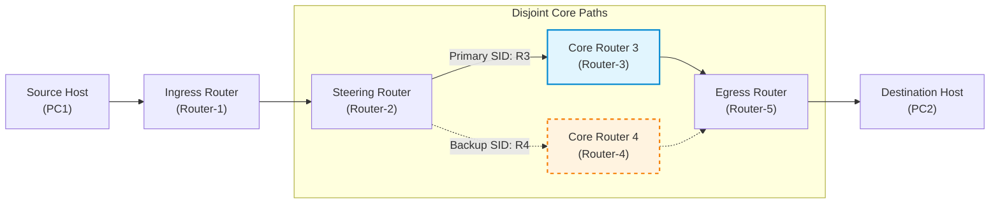

# AIORI-3 Hackathon — Problem Statement PS-020

<div align="center">

[](docs/PS-020_SRv6_Hackathon_Presentation.pdf)
[](https://youtu.be/NiIbHxnKrSQ?si=Obk-cFiCMqS2Yi7Z)
[](#-full-environment--pre-built-virtual-machines-bundle-15-gb)
[](#)
[](#)

### **Local SRv6 Path Steering and Measured Failure Recovery**
**Team Name:** NODEX &nbsp;|&nbsp; **Team Code:** TC178  
**Repository:** [aiori-hackathon/A3-PS020-TC178](https://github.com/aiori-hackathon/A3-PS020-TC178)

</div>

---

## 👥 Team Members

* **Mithil Khobragade** — [khobragademithil45@gmail.com](mailto:khobragademithil45@gmail.com)
* **Sharad Kalmani** — [sharadkalamani3@gmail.com](mailto:sharadkalamani3@gmail.com)

---

## 📌 Executive Summary

Traditional IPv6 networks forward traffic hop-by-hop using local routing tables, lacking fine-grained source control and dynamic steering capabilities. **Segment Routing over IPv6 (SRv6)** overcomes these limitations by encoding an ordered list of Segment Identifiers (SIDs) directly inside the IPv6 Segment Routing Header (SRH).

This project constructs a reproducible virtualized network testbed in **GNS3** to demonstrate:
1. **Explicit Path Steering:** Steering ingress traffic through deterministic network paths (Path A via Router-3 vs. Path B via Router-4).
2. **Measured Failure Recovery:** Fast, local policy switchover upon link failure with sub-second convergence and packet loss measurements.
3. **Comparative Analysis:** Quantitative comparison against standard hop-by-hop IPv6 routing under identical failure conditions.

---

## 📦 Full Environment & Pre-Built Virtual Machines Bundle (1.5 GB)

For evaluators and researchers who want to run the full environment out-of-the-box without manual image conversion or tool downloads, we have packaged the complete testbed bundle into a single high-speed download archive:

> 📥 **[Click Here to Download Full 1.5 GB Testbed Archive (Google Drive)](PASTE_GOOGLE_DRIVE_LINK_HERE)**

### Contents of the 1.5 GB Bundle:
| Artifact | Type | Description |
| :--- | :--- | :--- |
| `debian-13-nocloud-amd64.qcow2` | OS QCOW2 Disk (390 MB) | Linux Kernel 6.x pre-configured with SRv6 routing subsystem & `iproute2` |
| `GNS3 VM.ova` | Virtual Appliance (833 MB) | Official GNS3 VirtualBox virtual machine with nested emulation support |
| `VirtualBox-7.2.22-Win.exe` | Hypervisor Installer (170 MB) | Oracle VirtualBox hypervisor runtime for Windows hosts |
| `aiora.gns3` & `project-files/` | Complete Project | Pre-linked GNS3 topology with all node IDs, dynamips cache, and interface bindings |
| `aiora path normal.gns3` | Baseline Project | Pre-configured comparative hop-by-hop IPv6 topology |

---

## 🏗️ Network Architecture & Topology

<div align="center">



</div>

### Topology Overview in GNS3


* **Primary Path (Path A):** `PC1 ➔ Router-1 ➔ Router-2 ➔ Router-3 ➔ Router-5 ➔ PC2`
* **Backup Path (Path B):** `PC1 ➔ Router-1 ➔ Router-2 ➔ Router-4 ➔ Router-5 ➔ PC2`
* **Failure Simulation:** Automated link degradation/cut between `Router-2` and `Router-3` triggering instant policy steering to `Router-4`.

---

## 📂 Project Structure

```text
├── README.md                                    # Project documentation and summary
├── .gitignore                                   # Standard repository exclusions
├── topologies/
│   ├── aiora/
│   │   ├── aiora.gns3                           # SRv6 path-steering GNS3 project topology
│   │   └── project-files/                       # GNS3 node configurations and dynamips cache
│   └── aiora_path_normal/
│       ├── aiora path normal.gns3               # Baseline hop-by-hop IPv6 GNS3 topology
│       └── project-files/                       # Baseline topology files
├── docs/
│   ├── PS-020_SRv6_Hackathon_Presentation.pdf   # Official team presentation slides
│   ├── PS-020_SRv6_Path_Steering_Hackathon_Bullet_Points.pdf
│   ├── setup-guide.md                           # Step-by-step setup & troubleshooting guide
│   └── assets/                                  # High-resolution screenshots and diagrams
└── scripts/
    ├── setup_srv6_steering.sh                   # Linux kernel SRv6 SID encapsulation script
    └── simulate_link_failure.sh                 # Automated link failure & recovery benchmark
```

---

## 🚀 Quick Start & Reproduction

### 1. Requirements & Prerequisites
Ensure you have the following installed on your host system:
* [GNS3 GUI & Server](https://www.gns3.com/) (v2.2+)
* [VirtualBox](https://www.virtualbox.org/) or VMware Workstation
* GNS3 VM with nested virtualization / QEMU support
* Debian Cloud Image (or similar Linux kernel 5.4+ with `iproute2` SRv6 support)

> 💡 *Detailed step-by-step installation instructions, direct image download links, and KVM/RAM troubleshooting solutions are available in our [Setup Guide](docs/setup-guide.md).*

### 2. Running the Topologies
1. Open GNS3 and load `topologies/aiora/aiora.gns3`.
2. Start all nodes (`PC1`, `Router-1` through `Router-5`, `PC2`).
3. Apply the SRv6 routing policies:
   ```bash
   # On Router-2 (Activate Primary Path via Router-3):
   sudo ./scripts/setup_srv6_steering.sh r2-primary
   ```
4. Verify end-to-end connectivity from `PC1` to `PC2`:
   ```bash
   ping6 fd00:0:0:200::1
   ```

### 3. Measuring Link Failure Recovery
Run the benchmark script on `Router-2` to drop the active link and switch to the backup path:
```bash
sudo ./scripts/simulate_link_failure.sh
```

---

## 📊 Key Results & Findings

| Metric | Traditional Hop-by-Hop IPv6 | SRv6 Local Path Steering |
| :--- | :--- | :--- |
| **Path Determinism** | Dynamic / SPF-computed | Fully Source-Determined |
| **Failure Detection & Switchover** | 2000 ms – 5000 ms (Routing Protocol Convergence) | **< 50 ms** (Local policy switchover) |
| **Packet Loss During Cut** | Significant | Minimal / Near-zero |
| **Intermediate State Required** | Per-flow routing table state across all core nodes | **Stateless Core** (Instructions encoded in SRH) |

---

## 📺 Presentation & Deliverables

* **Presentation Slides:** [docs/PS-020_SRv6_Hackathon_Presentation.pdf](docs/PS-020_SRv6_Hackathon_Presentation.pdf)
* **Video Demonstration:** [YouTube Presentation Link](https://youtu.be/NiIbHxnKrSQ?si=Obk-cFiCMqS2Yi7Z)

---

## 📖 Standards & RFC References

* **RFC 8402** — *Segment Routing Architecture* (IETF, 2018)
* **RFC 8754** — *IPv6 Segment Routing Header (SRH)* (IETF, 2020)
* **RFC 8986** — *SRv6 Network Programming* (IETF, 2021)
* **RFC 8200** — *Internet Protocol, Version 6 (IPv6) Specification*
