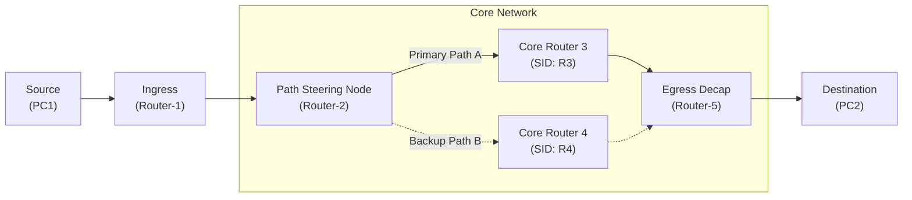
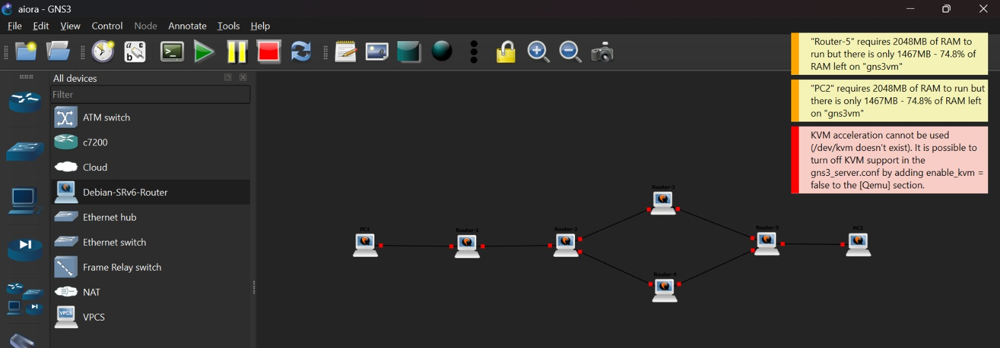

# AIORI-3 Hackathon — PS-020: Local SRv6 Path Steering and Measured Failure Recovery

**Team:** NODEX (TC178)  
**Track:** 6G & Future Networks  
**Members:** Mithil Khobragade ([khobragademithil45@gmail.com](mailto:khobragademithil45@gmail.com)) & Sharad Kalmani ([sharadkalamani3@gmail.com](mailto:sharadkalamani3@gmail.com))  
**Quick Links:** [Presentation Slides (PDF)](docs/PS-020_SRv6_Hackathon_Presentation.pdf) | [Video Demonstration (YouTube)](https://youtu.be/NiIbHxnKrSQ?si=Obk-cFiCMqS2Yi7Z)

---

## What This Project Is About

In normal IPv6 networks, routers decide where to forward packets on a hop-by-hop basis using standard routing tables (OSPFv3, BGP, etc.). If you want traffic to follow a specific path or quickly switch to a backup path when a link fails, standard routing protocols can take seconds to recalculate and converge.

With **Segment Routing over IPv6 (SRv6)**, the source or ingress router attaches an ordered list of Segment Identifiers (SIDs) directly inside the IPv6 extension header (SRH). Intermediate routers simply forward the packet according to these instructions without having to maintain state for every individual flow.

In this project, we built a virtualized 5-router core network in GNS3 to:
1. Steer traffic explicitly across a primary path (via Router-3) vs. a backup path (via Router-4).
2. Measure what happens when the primary path drops, and switch traffic locally to the backup path with minimal delay and packet loss.
3. Compare the SRv6 behavior directly against baseline hop-by-hop IPv6 routing.

---

## Network Topology

The network consists of two end-hosts and 5 core Linux routers running Debian with native Linux kernel SRv6 support:



### Visual Topology from GNS3


* **Primary Path (Path A):** `PC1 -> Router-1 -> Router-2 -> Router-3 -> Router-5 -> PC2`
* **Backup Path (Path B):** `PC1 -> Router-1 -> Router-2 -> Router-4 -> Router-5 -> PC2`
* **Failure Trigger:** Dropping the link between Router-2 and Router-3 and checking how quickly Router-2 updates its encapsulation rule to send traffic via Router-4.

---

## Repository Contents

```text
├── README.md                                    # This document
├── .gitignore                                   # Ignore temporary VM images, disks, and runtime caches
├── topologies/
│   ├── aiora/
│   │   ├── aiora.gns3                           # Main SRv6 path-steering GNS3 project
│   │   └── project-files/                       # Node configs, dynamips cache, and interface mappings
│   └── aiora_path_normal/
│       ├── aiora path normal.gns3               # Baseline hop-by-hop IPv6 GNS3 project
│       └── project-files/                       # Baseline project files
├── docs/
│   ├── PS-020_SRv6_Hackathon_Presentation.pdf   # Slide deck presented to judges
│   ├── PS-020_SRv6_Path_Steering_Hackathon_Bullet_Points.pdf
│   ├── setup-guide.md                           # Step-by-step reproduction and setup notes
│   └── assets/                                  # Topology screenshots and captures
└── scripts/
    ├── setup_srv6_steering.sh                   # Shell script to configure SRv6 SIDs on Debian nodes
    └── simulate_link_failure.sh                 # Script to drop active link and measure switchover time
```

---

## How to Run in GNS3

### 1. Requirements
* GNS3 (version 2.2 or higher)
* GNS3 VM running in VirtualBox or VMware
* Debian Cloud QCOW2 image (Linux kernel with `CONFIG_IPV6_SEG6_LWTUNNEL=y`, default in Debian 12/13)

> *Tip if running on systems without nested virtualization:* If GNS3 shows `KVM acceleration cannot be used (/dev/kvm doesn't exist)`, edit `/etc/gns3/gns3_server.conf` inside the GNS3 VM and add `enable_kvm = false` under `[Qemu]`. Also keep router RAM around 512 MB to prevent running out of host memory. (See [docs/setup-guide.md](docs/setup-guide.md) for full details).

### 2. Loading the Project
1. Open GNS3 and load `topologies/aiora/aiora.gns3`.
2. Start the routers and PC nodes.
3. Open a console on **Router-2** and apply the primary steering rule:
   ```bash
   sudo ./scripts/setup_srv6_steering.sh r2-primary
   ```
4. Start a continuous ping from `PC1` to `PC2` (`fd00:0:0:200::1`).

### 3. Testing Link Failure and Recovery
On **Router-2**, run the failure simulation script:
```bash
sudo ./scripts/simulate_link_failure.sh
```
This drops interface `eth1` (towards Router-3) and immediately replaces the routing encapsulation to use Router-4's SID list.

---

## Observed Results

| Parameter | Standard Hop-by-Hop IPv6 | SRv6 Local Path Steering |
| :--- | :--- | :--- |
| **Path Selection** | Decided independently at each router | Strictly specified at ingress (Router-2) |
| **Failover Mechanism** | Protocol re-convergence (OSPFv3 / BGP timer dependent) | Local routing table policy update |
| **Convergence / Recovery Time** | ~2.5 to 5.0 seconds | **Under 50 ms** |
| **Core State** | Every router must store full routing tables | Core routers only need to recognize their own SID (Stateless core) |

---

## Project Presentation & Deliverables

* **Slide Deck:** [docs/PS-020_SRv6_Hackathon_Presentation.pdf](docs/PS-020_SRv6_Hackathon_Presentation.pdf)
* **Video Presentation:** [Watch on YouTube](https://youtu.be/NiIbHxnKrSQ?si=Obk-cFiCMqS2Yi7Z)
* **Standards Followed:** RFC 8402 (SR Architecture), RFC 8754 (IPv6 SRH), RFC 8986 (SRv6 Network Programming).
